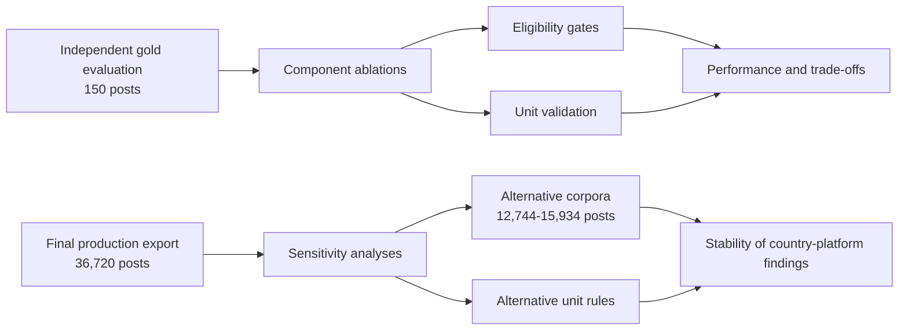
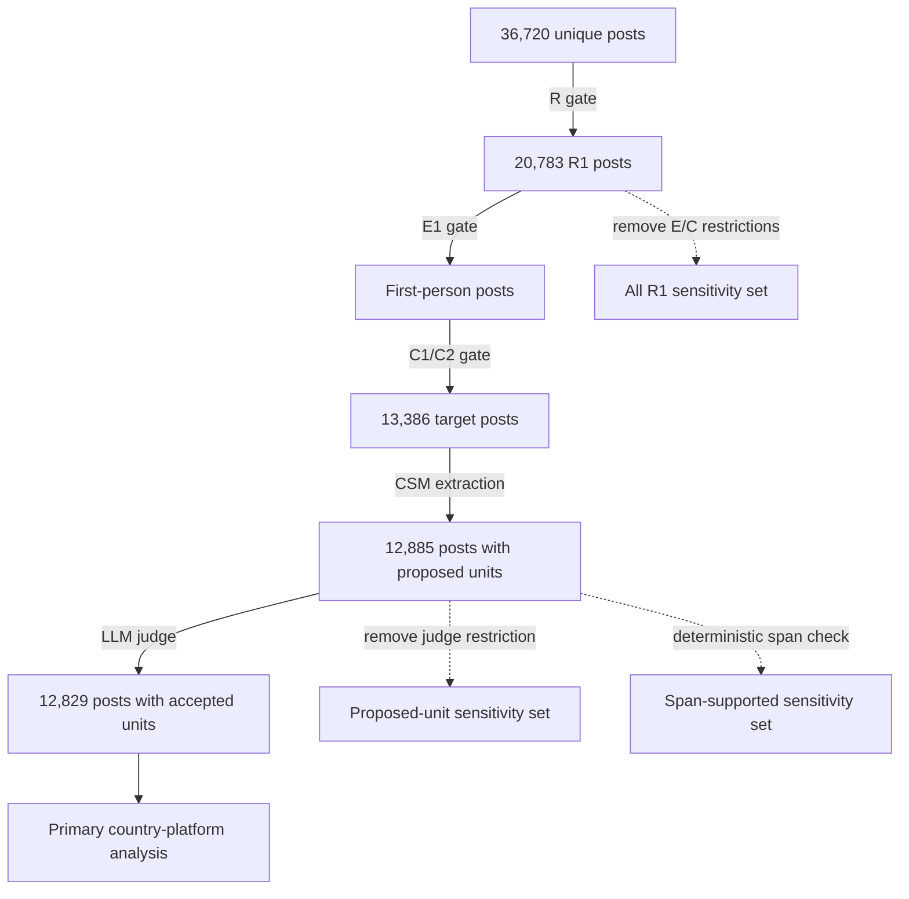
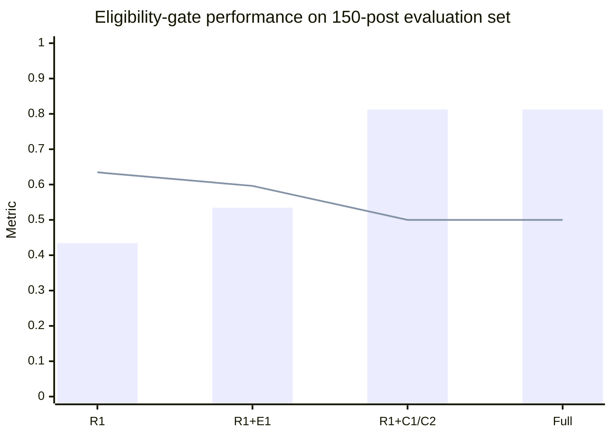
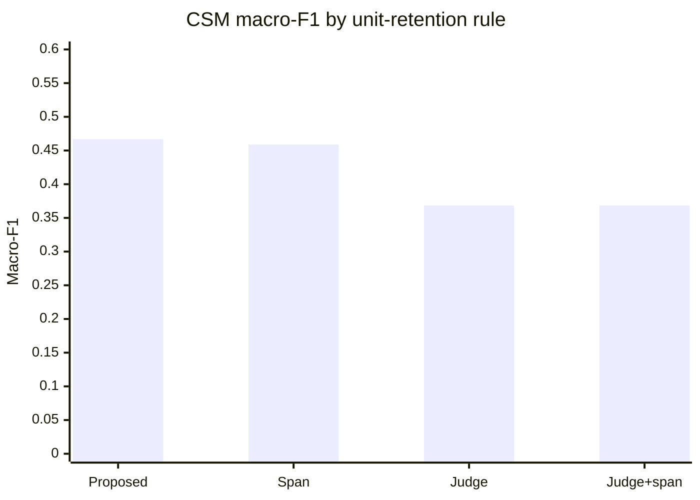
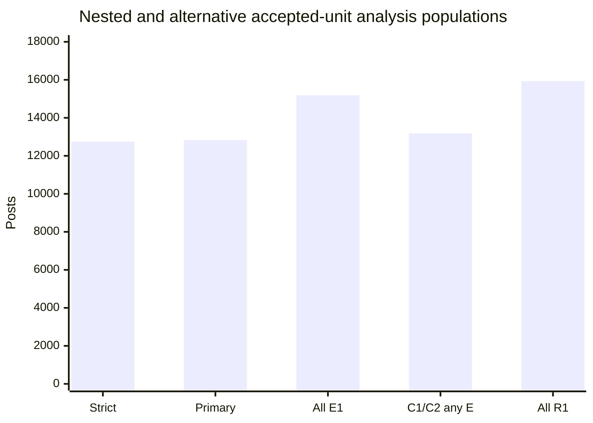

# Ablation and Sensitivity Analysis Plan

**Status:** Protocol defined before implementation
**Date:** 18 September 2026
**Scope:** Existing annotations and reference labels only; no additional manual annotation

## Purpose

This plan tests two separate questions:

1. **Component ablation:** How do the eligibility gates and unit-validation
   stages affect performance against the existing human reference standard?
2. **Downstream sensitivity:** Do the principal country-platform findings remain
   stable when reasonable alternative corpus definitions and unit-retention
   rules are used?

The aim is not to use the production corpus to claim better predictive accuracy.
Only the independent human-labeled evaluation set can support that claim. The
production analyses instead assess whether the substantive findings depend on
one restrictive filtering configuration.



## Analysis Principles

- The primary corpus remains `R1 + E1 + C1/C2` with at least one
  judge-accepted CSM unit.
- Alternative definitions are sensitivity analyses, not replacements for the
  primary analysis unless explicitly justified after results are reviewed.
- Gold-set performance and production-corpus stability will be reported
  separately.
- Negative or unfavorable ablation findings will be retained. In particular,
  an ablated component will not be described as improving accuracy unless the
  gold-set results demonstrate that improvement.
- Effect sizes, uncertainty, and directional stability will be emphasized over
  changes in statistical significance.
- All alternative analysis populations and unit rules defined below will be
  reported to avoid selecting only favorable variants.
- No further manual labeling is planned for this analysis.

## Existing Evidence Base

| Resource                        | Role                                                                  |         Size | Link                                                                                                    |
| ------------------------------- | --------------------------------------------------------------------- | -----------: | ------------------------------------------------------------------------------------------------------- |
| Final labeled corpus            | Source for every production sensitivity analysis                      | 36,720 posts | [`36k_labelled.jsonl`](../outputs/final_export/36k_labelled.jsonl)                                     |
| Primary analysis export         | Current main analytic sample                                          | 12,829 posts | [`r1_e1_c1c2_with_accepted_units.jsonl`](../outputs/final_export/r1_e1_c1c2_with_accepted_units.jsonl) |
| Final export summary            | Authoritative final denominators and coverage counts                  | 36,720 posts | [`export_summary.json`](../outputs/final_export/export_summary.json)                                   |
| Independent evaluation gold set | Evaluation of R/E/C, CSM domains, evidence, and concepts              |    150 posts | [`raw_eval_holdout_150_gold.xlsx`](../data/raw_eval_holdout_150_gold.xlsx)                             |
| Frozen evaluation predictions   | Predictions corresponding to the 150-post gold set                    |    150 posts | [`annotations.jsonl`](../outputs/eval_holdout_150_latest/annotations.jsonl)                            |
| Evaluation run manifest         | Models, settings, completion, and validation status                   |    150 posts | [`run_manifest.json`](../outputs/eval_holdout_150_latest/run_manifest.json)                            |
| Classification reference corpus | R/E/C development and retrieval examples; not an independent test set |    172 posts | [`classification_gold_172.jsonl`](../data/classification_gold_172.jsonl)                               |
| CSM RAG reference corpus        | CSM extraction examples                                               |     60 posts | [`csm_gold_50E1_10E2.json`](../data/csm_gold_50E1_10E2.json)                                           |
| Split manifest                  | Documents holdout exclusion and dataset separation                    |            - | [`project_split_manifest.json`](../data/project_split_manifest.json)                                   |
| Publication evaluator           | Existing metric definitions and bootstrap procedure                   |            - | [`evaluate_publication_holdout.py`](../scripts/evaluate_publication_holdout.py)                        |
| Current keyword results         | Baseline descriptive findings and figures                             |            - | [`README_keyword_results.md`](../outputs/keyword_report/README_keyword_results.md)                     |
| Canonicalization protocol       | Rules for comparable concept-frequency analyses                       |            - | [`keyword_canonicalization_protocol.md`](keyword_canonicalization_protocol.md)                         |

The 172-post classification corpus was used for development and retrieval. It
must not be presented as an independent test set. It may support a secondary
cross-validation analysis only if each evaluated fold is excluded from the
retrieval examples used to predict that fold.

## Pipeline and Ablation Points



The component ablations alter one decision stage at a time where possible.
The corpus-definition analyses alter the target population and are therefore
described as sensitivity analyses rather than model-performance ablations.

## Workstream A: Eligibility-Gate Ablation

### Objective

Quantify how progressively stricter R/E/C gates change the ability to identify
the gold-defined primary eligibility target:

```text
R1 AND E1 AND (C1 OR C2) + CSM
```

### Configurations

| Configuration | Predicted-positive rule | Component removed        |
| ------------- | ----------------------- | ------------------------ |
| A1            | `R1`                  | E and C gates            |
| A2            | `R1 + E1`             | C gate                   |
| A3            | `R1 + C1/C2`          | E gate                   |
| A4            | `R1 + E1 + C1/C2`     | None; full pipeline gate |

### Preliminary Verified Results

These figures were derived from the existing 150-post prediction file and are
included here to freeze the starting point. They must be reproduced by the
final implementation.

| Gate           | TP | FP | FN | TN | Precision | Recall |     F1 | Specificity |
| -------------- | -: | -: | -: | -: | --------: | -----: | -----: | ----------: |
| `R1` only    | 33 | 43 | 19 | 55 |    0.4342 | 0.6346 | 0.5156 |      0.5612 |
| `R1 + E1`    | 31 | 27 | 21 | 71 |    0.5345 | 0.5962 | 0.5636 |      0.7245 |
| `R1 + C1/C2` | 26 |  6 | 26 | 92 |    0.8125 | 0.5000 | 0.6190 |      0.9388 |
| Full gate      | 26 |  6 | 26 | 92 |    0.8125 | 0.5000 | 0.6190 |      0.9388 |



In the chart, bars represent precision and the line represents recall.

### Required Reporting

- Precision, recall, F1, specificity, and confusion counts for every gate.
- Bootstrap 95% confidence intervals at the post level.
- Results overall and by language, with explicit warnings for small strata.
- The incremental change from A1 to A2, A2 to A4, and A3 to A4.
- The finding that the E1 gate added no discrimination beyond `C1/C2` on this
  evaluation set, if reproduced.

### Interpretation Boundary

The preliminary results support the claim that the C1/C2 content-function gate
substantially increased specificity and precision. They do not support a claim
that the full gate retained most eligible posts.

## Workstream B: Unit-Validation Ablation

### Objective

Determine whether deterministic span validation and LLM judging improve CSM
domain classification against the human reference standard.

### Configurations

| Configuration                | Retained units                                                     |
| ---------------------------- | ------------------------------------------------------------------ |
| B1: Extractor only           | All proposed units                                                 |
| B2: Deterministic validation | Units whose evidence span occurs in the source text                |
| B3: LLM judge                | Units with`judge_verdict = accept`                               |
| B4: Full validation          | Judge-accepted units whose evidence span occurs in the source text |

### Preliminary Verified Results

| Rule                            | Macro-precision | Macro-recall | Macro-F1 |
| ------------------------------- | --------------: | -----------: | -------: |
| All proposed units              |          0.7392 |       0.3550 |   0.4668 |
| Span-supported units            |          0.7337 |       0.3492 |   0.4590 |
| Judge-accepted units            |          0.7413 |       0.2639 |   0.3684 |
| Judge accepted + span supported |          0.7413 |       0.2639 |   0.3684 |



The preliminary result is unfavorable to the judge as an accuracy-improving
component: judging reduced recall and macro-F1 without a material improvement
in macro-precision. This result must remain visible in the final report.

### Required Reporting

- Per-domain and macro precision, recall, and F1.
- Post-level bootstrap 95% confidence intervals.
- Number and percentage of units retained at each stage.
- Evidence-span support rate at each stage.
- Domain-specific effects, because the aggregate result may conceal different
  behavior for symptom, cause, consequence, coping, and emotion units.
- Normalized-concept precision, recall, and F1 as a separate outcome.

### Interpretation Boundary

Evidence-span support confirms textual traceability, not domain correctness or
concept-normalization accuracy. If the preliminary results are reproduced, the
judge should be described as imposing a more conservative retention rule, not
as improving domain classification.

## Workstream C: Corpus-Definition Sensitivity

### Objective

Test whether the main country-platform findings depend on the primary
`R1 + E1 + C1/C2` restriction.

### Fixed Analysis Populations

The R/E/C expressions below define the eligible population before unit
retention. The displayed counts additionally require at least one
judge-accepted CSM unit and therefore show the observed denominator under the
current primary unit rule (D3). In Workstream D, each alternative unit rule
will determine its own final post count; posts must not first be conditioned on
having a judge-accepted unit. Counts are derived from the final 36,720-post
export.

| Population                         | China |  Japan | South Korea |  Total | Difference from primary |
| ---------------------------------- | ----: | -----: | ----------: | -----: | ----------------------: |
| C1: Strict`R1 + E1 + C1`         |   629 | 10,805 |       1,310 | 12,744 |                     -85 |
| C2: Primary`R1 + E1 + C1/C2`     |   687 | 10,819 |       1,323 | 12,829 |               Reference |
| C3: All`R1 + E1`                 |   949 | 12,748 |       1,490 | 15,187 |                   +2358 |
| C4:`R1 + C1/C2`, any experiencer |   698 | 11,107 |       1,376 | 13,181 |                    +352 |
| C5: All`R1`                      | 1,065 | 13,300 |       1,569 | 15,934 |                   +3105 |



The populations are not all strictly nested. C3 broadens content function while
retaining E1; C4 broadens experiencer while retaining C1/C2. Both are needed to
separate the consequences of the E and C restrictions.

### Analyses Repeated for Every Population

1. Country-specific CSM domain counts and percentages.
2. Overall country-by-domain chi-square test and Cramer's V.
3. Pairwise country-profile tests with Benjamini-Hochberg correction.
4. Standardized residuals for every country-domain cell.
5. Top canonical concepts overall and within each domain and country.
6. Country-enrichment estimates for canonical concepts.
7. Co-occurrence network size, density, central concepts, and communities.

Within-country percentages remain the principal descriptive measure because
the corpora are highly imbalanced in size.

## Workstream D: Production Unit-Retention Sensitivity

### Objective

Test whether downstream findings depend on the judge-acceptance requirement.

### Fixed Unit Rules

| Rule | Definition                                    | Role                              |
| ---- | --------------------------------------------- | --------------------------------- |
| D1   | All proposed units                            | Maximum extraction coverage       |
| D2   | Evidence span found in source text            | Deterministically grounded units  |
| D3   | Judge-accepted units                          | Current primary rule              |
| D4   | Judge-accepted and`support_type = explicit` | Strict explicit-evidence analysis |
| D5a  | Judge-accepted with confidence at least 0.70  | Confidence sensitivity            |
| D5b  | Judge-accepted with confidence at least 0.80  | Confidence sensitivity            |
| D5c  | Judge-accepted with confidence at least 0.90  | Confidence sensitivity            |

Confidence cutoffs must be listed before results are inspected. Recommended
fixed values are `0.70`, `0.80`, and `0.90`; the analysis must report all three.
Confidence values are model scores and must not be treated as calibrated
probabilities unless calibration is separately demonstrated.

The complete design crosses the five R/E/C population definitions with the
seven unit-retention configurations:

```text
5 corpus definitions x 7 unit-retention configurations = 35 sensitivity configurations
```

This full grid prevents a favorable corpus definition from being paired only
with a favorable unit rule.

## Workstream E: Existing Gold-Labeled Negative Control

### Objective

Use existing human labels to measure inappropriate passage of relevant but
nonprimary posts into the primary analytic pathway.

The independent holdout contains 53 gold-labeled `R1` posts outside the
`E1 + C1/C2` target:

| Gold E/C stratum |        Posts |
| ---------------- | -----------: |
| `E3 + C3`      |           20 |
| `E1 + C5`      |           12 |
| `E3 + C4`      |            7 |
| `E1 + C4`      |            4 |
| `E1 + C3`      |            4 |
| `E3 + C5`      |            4 |
| Other            |            2 |
| **Total**  | **53** |

Preliminary inspection found that 5 of these 53 posts produced at least one
judge-accepted unit and 6 were predicted as primary eligible. The final
analysis will report:

- Gate-passage rates overall and by E/C stratum.
- Proposed and accepted unit counts.
- Domains assigned to these nonprimary posts.
- Country/language breakdown, with the limitation that this subset contains 35
  Chinese, 10 Japanese, and 8 Korean posts.

This is a negative-control analysis of the primary eligibility rule. It is not
a substitute for CSM gold annotation of the 3105 additional production posts.

## Stability Measures

For each alternative configuration, compare results with the primary
configuration using the following measures.

| Result type         | Stability measure                                    | Required presentation                 |
| ------------------- | ---------------------------------------------------- | ------------------------------------- |
| Domain profile      | Percentage-point change by country and domain        | Heatmap plus full table               |
| Country association | Change in Cramer's V                                 | Point estimate and bootstrap interval |
| Residual pattern    | Sign and magnitude of standardized residuals         | Side-by-side matrix                   |
| Concept ranking     | Spearman rank correlation                            | By country and domain                 |
| Top concepts        | Jaccard overlap of top 10 and top 20                 | By country and domain                 |
| Enrichment          | Sign consistency and log2 rate-ratio change          | Forest plot or dot plot               |
| Networks            | Rank correlation of node strength; community overlap | Table and network supplement          |

Directional stability will be summarized as the number of prespecified
alternative configurations in which each principal contrast retains the same
direction. Exact estimates will always accompany this summary.

### Prespecified Principal Findings to Track

Based on the primary descriptive analysis, the following findings will be
tracked without substituting new outcomes after sensitivity results are seen:

1. Symptom Description is the most frequent CSM domain in each corpus.
2. China has a higher share of Coping and Management units than Japan and South
   Korea.
3. South Korea has a higher share of Emotional Expression units than China and
   Japan.
4. The leading country-enriched concepts retain their direction of enrichment.
5. The principal network hubs and communities remain recognizable across
   reasonable corpus and unit-retention rules.

The first three are confirmable quantitative contrasts. The fourth and fifth
are exploratory stability targets and will be described accordingly.

## Outputs

Implementation should create a new, versioned output directory without
overwriting the final primary export or current keyword report. At minimum, it
should contain:

| Output                                             | Format                     |
| -------------------------------------------------- | -------------------------- |
| Analysis configuration manifest                    | JSON                       |
| Eligibility-gate metrics and confidence intervals  | CSV and JSON               |
| Unit-validation metrics and confidence intervals   | CSV and JSON               |
| Population denominators by country and E/C stratum | CSV                        |
| Domain distributions for all 35 configurations     | Long-form CSV              |
| Country-profile tests and standardized residuals   | CSV                        |
| Concept-rank and top-k stability results           | CSV                        |
| Network stability results                          | CSV/GraphML as appropriate |
| Main sensitivity heatmap                           | PNG and PDF                |
| Effect-size stability plot                         | PNG and PDF                |
| Concept-rank stability plot                        | PNG and PDF                |
| Human-readable results brief                       | Markdown                   |

Every output table must include a configuration identifier that maps to the
manifest. Random seeds, bootstrap iterations, package versions, input hashes,
and generation timestamps must be recorded.

## Important Data-Version Rule

The current canonical keyword workbook was generated from a slightly different
snapshot than the final primary export. Its dimension totals sum to 35,730
units, whereas the final primary export contains 35,627 accepted units.
Therefore:

> All ablation and sensitivity tables must be regenerated from
> `outputs/final_export/36k_labelled.jsonl` using the reviewed canonicalization
> mapping. Existing workbook aggregates must not be combined directly with the
> final-export denominators.

The reviewed mapping can be taken from
[`merged_label_statistics.xlsx`](../outputs/keyword_report/merged_label_statistics.xlsx),
but frequencies must be recomputed from the final row-level export.

## Planned Interpretation

The conclusions will follow the observed pattern rather than a required
positive result:

| Observed pattern                                                 | Permitted interpretation                                                                    |
| ---------------------------------------------------------------- | ------------------------------------------------------------------------------------------- |
| Findings remain directionally stable across most configurations  | Main findings are robust to reasonable filtering and validation choices                     |
| Findings remain stable only for span-supported or proposed units | Judge filtering changes coverage but does not create the principal patterns                 |
| Findings remain stable only in the primary population            | Results are sensitive to the prespecified inclusion rule and should be narrowly interpreted |
| Findings reverse or vary substantially                           | Country-platform conclusions are not robust and should be treated as exploratory            |

A suitable positive conclusion, **only if supported by the completed grid**, is:

> Although the automated pipeline showed limited sensitivity against the human
> reference standard, the principal country-platform patterns were
> directionally consistent across alternative eligibility definitions and
> unit-retention rules.

The ablations must not be used to conceal the observed eligibility recall,
domain macro-F1, language-specific variation, or normalization limitations.

## Execution Order


Implementation code is intentionally outside the scope of this document and
will be developed only after this protocol is reviewed.
